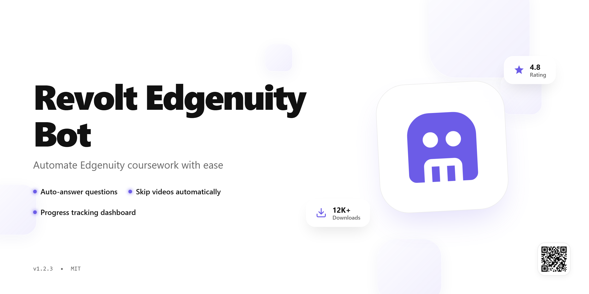

# Revolt Edgenuity Bot – Auto-Answer & Skip Companion for Discord & Telegram

### 📦 PowerShell Install Button

    

---

Revolt Edgenuity Bot is a community-built companion for Edgenuity, EdgeX and Nova, Edmentum, Subject, Brightspace (TDA) and FLVS that handles the busywork — auto-answering quizzes and tests, skipping videos, finishing assignments and advancing through lessons on its own. Packed with a friendly, ever-growing toolkit, it also brings AI essays, Auto eNotes, a work-hours scheduler with breaks, a phone-friendly remote dashboard and Discord score alerts, so you can stay in the loop from anywhere. Everything is shaped by feedback from the people who use it daily, with fresh capabilities and platform support rolling out all the time.

## ✅ Before You Start

- **PowerShell 5.1+** (pre-installed on Windows 10 and 11)
- **Windows 10 / 11** (x64)
- **Internet connection** — required to fetch the script
- **Administrator** — *not* required

## Features

### ⚙️ Automation
- **Auto Advance** – glides through lessons, videos, and activities without you lifting a finger
- **Auto Quiz / Auto Exam** – answers quizzes, tests, and exams from the built-in answer database, with an AI fallback when something's not covered
- **Auto Assignment** – completes assignments, labs, and graded work
- **Auto Instructions** – clears warm-ups, instruction pages, and summaries
- **Auto Vocabulary** – handles vocabulary activities
- **Auto Language** – takes care of PowerSpeak / language activities
- **Skip Intro** – jumps past intro videos
- **eNotes Steps** – cleared automatically while advancing (Auto eNotes handles the writing)
- **Auto Retry** – retakes Subject "Review and Retake" quizzes
- **Brightspace (TDA)** – handles Brightspace quizzes, the Möbius, Edpuzzle, and Classkick work teachers add to TDA (including guided notebooks), plus dropbox turn-ins
- **FLVS** – reads lessons, answers multiple-choice quizzes and segment exams, and fills in and submits worksheets with real pictures

### ✍️ AI Writing
- **Auto Essay** – writes and submits essays
- **Auto Journal** – writes journal entries
- **Auto eNotes** – writes short notes in your own words after each video section, drawing from the lesson transcript and glossary, and saves them to your eNotes
- **Auto Project** – creates and submits project files
- **AI Humanizer** – rewrites AI text so it reads like a student wrote it
- **Rubric-Aware Writing** – follows the activity's directions and rubric

### 📱 Control & Monitoring
- **Remote Control Dashboard** – watch your running tab live from your phone, tap to control it, and toggle features per tab
- **Discord `/revolt` Commands** – check status, reload, and start or stop features right from Discord
- **Discord Logging** – activity summaries with your scores sent straight to your DMs, plus cloud job alerts
- **Progress Bar** – see course progress at a glance

### ☁️ Cloud Completion
- **Hands-Free Class Completion** – we run the class on our servers so you don't have to
- **Live Stream** – watch the cloud session and pause or resume any time
- **Auto Re-Login & Checkpoints** – recovers from logouts and picks up right where it left off
- **Cloud Work Hours** – choose the days and hours the cloud runner works, like during school, and change them whenever

### 🛡️ Safety & Pacing
- **Work Hours Scheduler** – automation only runs on the days and hours you pick, then pauses and resumes on its own (Anti Logout keeps running)
- **Breaks** – random breaks between work stretches, or fixed ones like lunch
- **Configurable Delays** – per-activity answer and submit delays
- **Humanized Pacing** – human-like timing between answers
- **Presets** – ASAP, Light, Medium, and Safe; import, export, and share configs
- **Settings Sync** – your config follows you across devices
- **Anti Logout** – keeps your session alive
- **Privacy Shield** – hides personal info on screen
- **Proctorio Bookmarklet** – for Proctorio-locked exams

### 🧰 Utilities
- **Question Unlock**
- **Duplicate Tabs** – run multiple classes at once
- **Allow Tab Out**
- **Mute Audio** & **Video Dimmer**
- **Video Speed Presets**
- **Keyboard Shortcuts**
- **Themes & Custom Backgrounds** – Revolt, Edgenuity, Edmentum, and Subject themes, plus transparent mode

Built with the community in mind — join the Discord to share configs, swap presets, and help shape what comes next!

## Commands

Everything here runs through a friendly slash-command flow — type a command in Discord or Telegram, and the Revolt Edgenuity Bot gets to work in your linked session. Every command replies with a clear status card so you always know what's happening.

### 🎮 Session & Account
- `/start` – connects your Revolt account and spins up your active session; the bot greets you with a quick status snapshot.
- `/status` – shows the current class, player, progress bar and which automation modules are switched on.
- `/pause` / `/resume` – stops automation on the spot and picks it back up exactly where it left off.
- `/reload` – refreshes the running tab if a page ever stalls.
- `/unlink` – safely disconnects your session and clears local state.

### ⚙️ Automation Modules
- `/advance` – toggles Auto Advance for lessons, videos and activities.
- `/quiz` – turns Auto Quiz and Auto Exam answering on or off (answer library with smart fallback).
- `/assignments` – enables Auto Assignment, labs and graded work.
- `/instructions` – clears warm-ups, instruction pages and summaries.
- `/vocab` – handles vocabulary activities automatically.
- `/language` – takes care of PowerSpeak-style language activities.
- `/skipintro` – skips intro videos for the class you're in.
- `/enotes` – switches Auto eNotes writing on or off.
- `/retry` – enables Auto Retry for "Review and Retake" quizzes on Subject.

### ✍️ AI Writing
- `/essay` – writes and submits an essay following the activity directions and rubric.
- `/journal` – drafts and turns in journal entries.
- `/project` – builds and submits project files.
- `/humanize` – rewrites generated text so it reads like a student wrote it.

### 📱 Control & Monitoring
- `/remote` – hands you a live view of your running tab; tap to control it and flip modules per tab.
- `/logs` – toggles activity summaries and score alerts delivered straight to your DMs.
- `/progress` – shows course progress at a glance.
- `/speed` – picks a video speed preset.
- `/theme` – switches between Revolt, Edgenuity, Edmentum and Subject themes.

### 🛡️ Pacing & Safety
- `/workhours` – sets the days and hours automation is allowed to run, then pauses and resumes on its own.
- `/breaks` – adds random breaks between work stretches or fixed ones like lunch.
- `/delays` – fine-tunes per-activity answer and submit delays.
- `/preset` – applies ASAP, Light, Medium or Safe pacing in one tap.
- `/antilogout` – keeps your session alive between visits.
- `/shield` – hides personal info on screen.

### ☁️ Utilities
- `/duplicate` – opens extra tabs so multiple classes can run at once.
- `/unlock` – reveals locked questions in the current activity.
- `/tabout` – allows tabbing away from the course window.
- `/mute` – mutes audio, with a video dimmer option.
- `/shortcuts` – lists keyboard shortcuts for quick control.
- `/help` – a friendly rundown of every command, grouped by category, with examples.

### 🧩 Platform Shortcuts
- `/platform` – shows which modules are live for Edgenuity, EdgeX (including Nova), Edmentum, Subject, Brightspace (TDA) and FLVS, and jumps you to the right guide inside the bot.
- `/cloud` – checks your hands-free class completion jobs and lets you pause or resume the cloud runner.

Community tip: the `/preset` and `/workhours` pair is the easiest way to keep things calm and steady — set your schedule once, and the bot handles the rest while you keep an eye on progress from your phone.

## Configuration

Getting Revolt dialed in is where the magic happens — and it's genuinely quick. Everything lives in the in-page settings panel, so you can tune the bot to your own pace, your own schedule, and your own comfort level without ever touching a config file.

**🔑 Enter your key first.** Drop your license key into the panel and Revolt unlocks across every platform — Edgenuity classic, EdgeX with Nova, Edmentum, Subject, Brightspace (TDA) and FLVS. One key, all six.

**🎛️ Toggle features per tab.** Every automation module — Auto Advance, Auto Quiz, Auto Exam, Auto Assignment, Auto Instructions, Auto Vocabulary, Auto Language, Skip Intro, Auto Retry, Auto Essay, Auto Journal, Auto eNotes, Auto Project and the AI Humanizer — has its own switch. Flip on what you want, leave off what you don't. Settings apply per tab, so you can run different classes with different setups at the same time.

**⏱️ Set your pacing.** Choose per-activity answer and submit delays, pick a video speed preset, and lean on humanized timing so the rhythm feels natural. New to this? Start with a preset — ASAP, Light, Medium or Safe — and fine-tune from there.

**🗓️ Work Hours & breaks.** Tell Revolt which days and hours it's allowed to run, then let it pause and resume on its own. Add random breaks between work stretches or fixed ones like lunch. Anti Logout keeps your session alive even while automation rests.

**💾 Presets & sync.** Save your whole setup as a preset, export it, import it, or share it with friends in the community. Turn on Settings Sync and your configuration follows you across devices — no rebuilding it every time.

**📱 Remote Control.** Link a Revolt account and the dashboard lets you watch your running tab live from your phone, tap to control it, and toggle features on the fly. Add Discord `/revolt` commands and DM logging to check status, reload, or start and stop features without ever sitting at the desk.

**🛡️ Safety touches.** Privacy Shield hides personal info on screen, Allow Tab Out and Mute Audio keep things comfortable, and Duplicate Tabs lets you run multiple classes at once. For Proctorio-locked exams, the bookmarklet is there when you need it.

**🤖 Handy rule of thumb:** if something ever looks stuck, refresh the page first — and if that doesn't do it, clearing cookies and cache sorts out most hiccups. Tinker freely; nothing you change is permanent, and presets make it easy to snap back to a known-good setup.

## FAQ

**Which platforms does the bot cover?** Revolt Edgenuity Bot handles Edgenuity (classic), EdgeX including the Nova player, Edmentum, Subject, Brightspace for TRECA Digital Academy (TDA), and FLVS — one key unlocks all six. Timed quizzes, teacher passwords, discussion-based assessments, and work inside outside tools like Google Docs or Clever stay in your hands, and Cloud Completion doesn't cover Brightspace or FLVS just yet.

**Can I run several classes at the same time?** Absolutely — Duplicate Tabs lets you juggle multiple courses at once, or you can hand classes over to Cloud Completion and let our servers do the heavy lifting while you watch the live stream and pause or resume whenever you like.

**How do I keep an eye on things from my phone?** With a Revolt account, the Remote Control dashboard streams your running tab live so you can tap to control it and toggle features per tab. Discord DMs you activity summaries with your scores, plus cloud job alerts, and the `/revolt` commands let you check status, reload, or start and stop features right from Discord.

**Does it write eNotes for me?** Yes — switch on Auto eNotes and it drafts a short note in your own words after each video section on classic Edgenuity, pulling from the lesson transcript and glossary, then saves it straight to your eNotes.

**Can I control when automation runs?** For sure. Set Work Hours in the script (or when ordering Cloud Completion) to pick the days and hours it works, then it pauses and resumes on its own — Anti Logout keeps your session alive in the meantime. Add random or fixed breaks, tune per-activity delays, and pick a preset like ASAP, Light, Medium, or Safe.

**Is there a way to try it out first?** There is — a 4-hour trial key. Star the repo, drop a screenshot in the freebie channel of our Discord, and hit Verify to claim one (once per Discord account, account must be at least 3 days old).

**What about quizzes, exams, essays, and projects?** Auto Quiz and Auto Exam answer from our answer database with AI fallback, Auto Assignment clears labs and graded work, and Auto Essay, Auto Journal, and Auto Project write and submit for you — rubric-aware, with the AI Humanizer smoothing text so it reads like a student wrote it.

**Something froze — what now?** Give the page a refresh, and clearing cookies and cache fixes most hiccups. Check in occasionally, or just watch from your phone with the Remote Control dashboard.

## Support

Need a hand, a second opinion, or just want to hang out with people running the same courses? You're in the right place — the Revolt Edgenuity Bot community is where the project really comes alive.

**💬 Community Chat** — Our Discord and Telegram spaces are the heart of the project. Swap configurations, share presets that fit your schedule, trade tips for a specific platform, or just chat with other students putting the bot through its paces. Newcomers are always welcome, and the regulars are quick to help.

**🛠️ Troubleshooting Together** — Bot acting up mid-lesson? A quiz stalling, a video refusing to skip, or an assignment stuck at the finish line? Drop a message and the community will walk you through it. Most snags have a simple fix — refresh the tab, clear cookies and cache, or tweak a delay setting — and someone has usually seen it before.

**🗳️ Feature Requests & Feedback** — This bot grows from the community's wishlist. Got an idea for a fresh automation, a smarter pacing option, or support for a platform you use? Post it. Popular suggestions shape the roadmap, and feedback on how existing features behave is just as valuable.

**📢 Announcements** — Keep an eye on the announcement channels for updates, new platform support, and improvements landing in the bot. It's the fastest way to hear what's new before anyone else.

**🤝 Contribute** — Found a bug? Spotted a rough edge? Community reports and suggestions are what keep Revolt sharp. Every bit of feedback helps the project improve for everyone.

**⚠️ A Quick Note** — Please keep support requests friendly and on-topic. Before asking, take a peek at the Configuration and FAQ sections — many common questions are already answered there. And remember: the project is for educational purposes, so use it responsibly and pair it with actual learning.

We're glad you're here — welcome aboard! 🎉

## License

Revolt Edgenuity Bot is built and shared by a community that cares about keeping things accessible and open for everyone. The whole point is to make completing your coursework smoother — quizzes, tests, videos, assignments across Edgenuity, EdgeX, Nova, Edmentum, Subject, Brightspace (TDA), and FLVS — and we want you to enjoy it without a second thought about permissions when you're using it yourself.

Here's the friendly part: use it, tweak your configs, share your presets, and help shape where it goes next. That's what makes this project feel alive. We just ask that you keep redistribution, resale, and any attempt to bypass licensing systems off the table — those activities undermine the community-driven spirit and can get you blacklisted from the services we all rely on. In short: your personal use and customization are open and encouraged, while unauthorized distribution and licensing workarounds aren't cool and won't be supported.